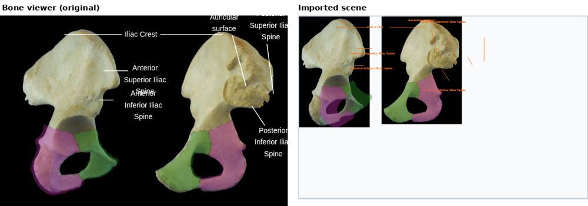
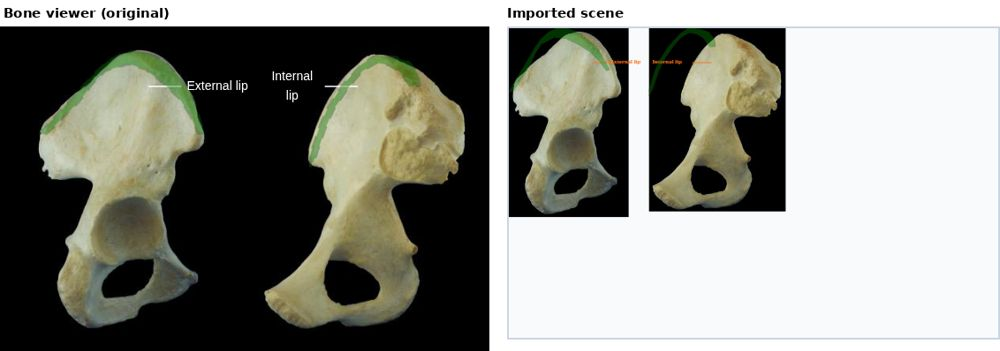
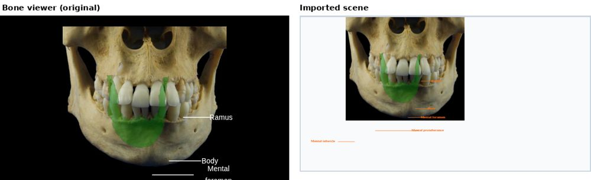
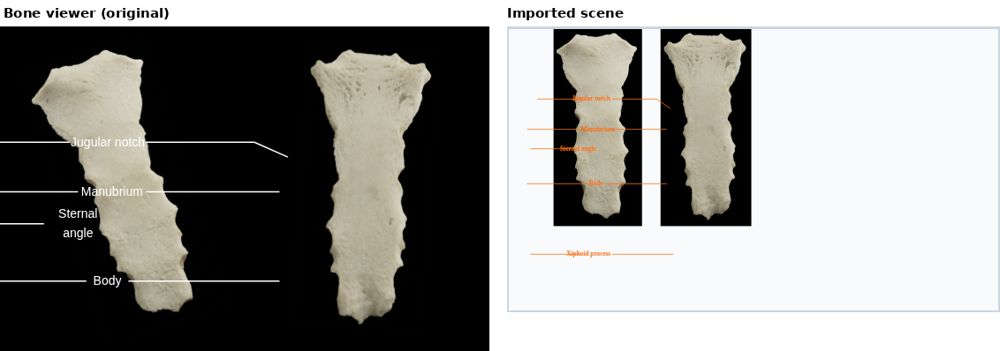
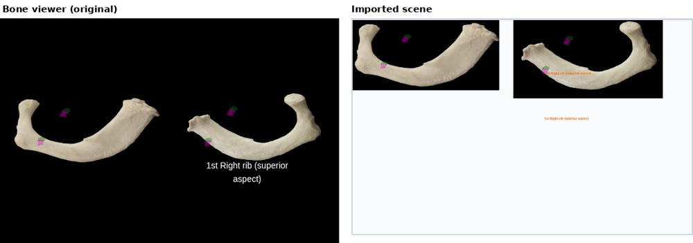
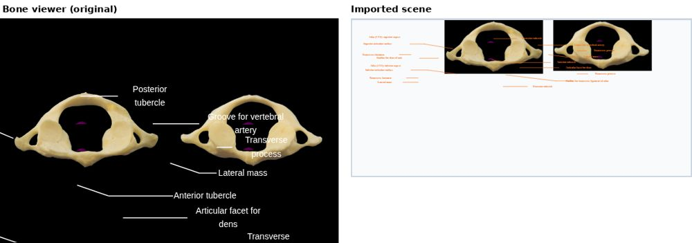
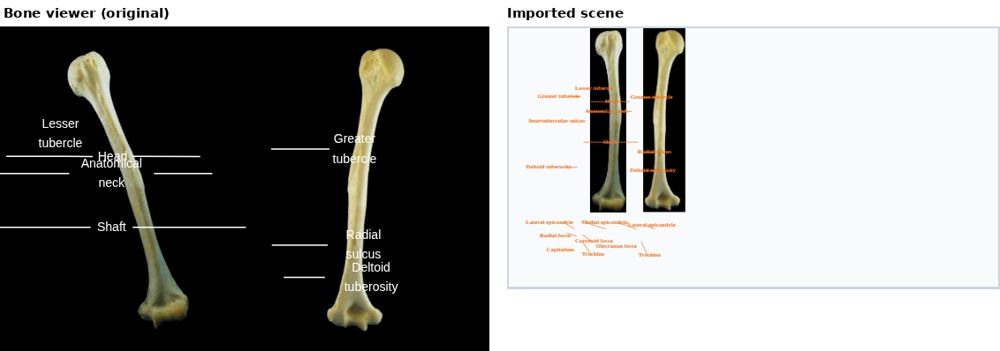
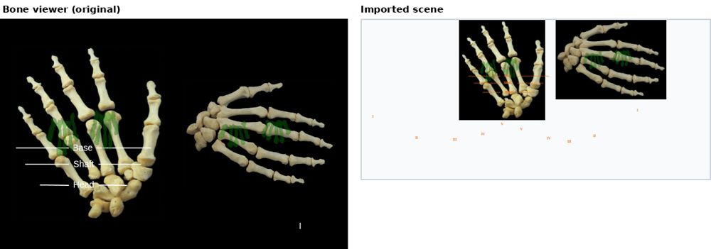
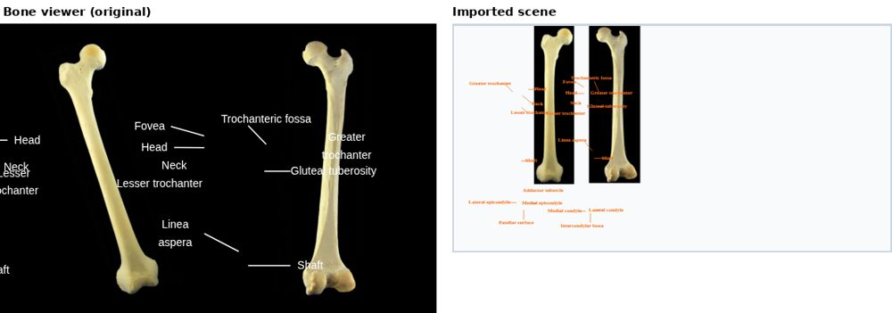
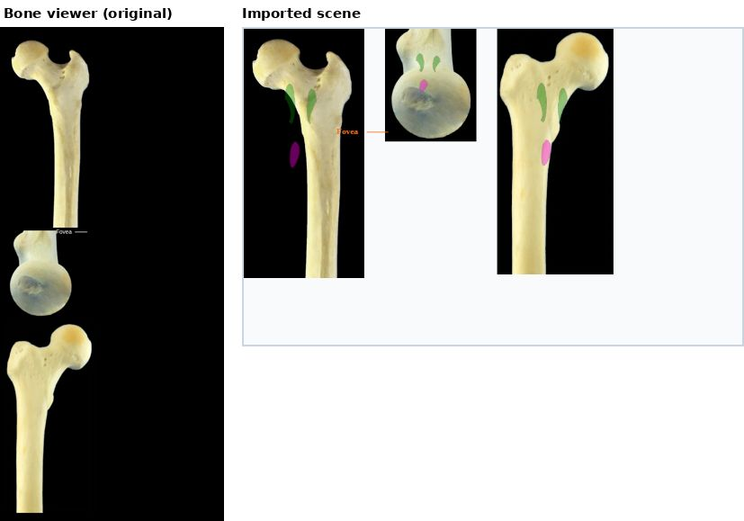

# Migrated scene validation (#468)

This is for issue #468, which is part of #463 (Preserve and Migrate Existing Content). The goal was to check that bone content imported into the Scene Editor still matches what students see in the bone viewer right now. The images come from the #466 import and the labels, pointer lines and colored regions come from #467.

I did not change any of the import code for this issue. #467 was already approved, so this is just checking what got merged and writing down where it is different from the viewer.

## What I did

I checked it three ways:

1. I picked 10 items so that every boneset is covered, and imported each one with Import bone images (with both "Also import" boxes checked). Then I put the import next to the same item in the bone viewer and compared them. I tried to get a mix: items with 1, 2 and 3 images, both formats of colored regions, some items with no colored regions, and some with a lot of labels.
2. I wrote `boneset-api/migrationValidation.test.js`, which imports all 200 items in the viewer's dropdowns and checks image order, image proportions, that the image files exist, labels, that annotations are linked to their image, and that colored regions land on the image. It runs as part of `npm test`.
3. I wrote `boneset-api/scripts/migration-report.js`, which makes [report.md](report.md). It lists what every item imports and what it doesn't (and why).

In the screenshots below the viewer is on the left and the imported scene is on the right (fit to width, like the Scene Editor shows it).

## Results for the 10 items

OK means it matches the viewer. Anything else is a difference, and the D number points to the explanation further down.

| Boneset | Item | Images | Order | Images/proportions | Colored regions | Labels and lines |
|---|---|---|---|---|---|---|
| Bony Pelvis | Ilium (bone) | 2 | OK | OK | Older format, a little off (D3) | Different (D1) |
| Bony Pelvis | Iliac crest (bone part) | 2 | OK | OK | Older format, a little off (D3) | Different (D1) |
| Skull | Anterior mandible (bone part) | 1 | OK | OK | OK | Different, 2 show up that the viewer hides (D1, D2) |
| Thorax | Sternum (bone) | 2 | OK | Upright, viewer tilts them (D4) | None in data | Different (D1, D2) |
| Thorax | First rib, head and neck (bone part) | 2 | OK | OK | OK | Different (D1, D2) |
| Vertebrae | Atlas (bone) | 2 | OK | OK | OK | Different, 10 show up that the viewer hides (D1, D2) |
| Upper Limb | Humerus (bone) | 2 | OK | Upright, viewer tilts them (D4) | None in data | Different, 12 show up that the viewer hides (D1, D2) |
| Upper Limb | Hand, metacarpals (bone part) | 2 | OK | OK | OK | Different, 9 show up that the viewer hides (D1, D2) |
| Lower Limb | Femur (bone) | 2 | OK | Upright, viewer tilts them (D4) | None in data | Different, 8 show up that the viewer hides (D1, D2) |
| Lower Limb | Femur, head (bone part) | 3 | OK | OK | Viewer doesn't show them (D5) | Different (D1, D5) |

Basically, the images work: the right ones get imported, in the right order, with the right proportions, and they use the original files. Colored regions in the newer format also line up. The main problem is that labels and pointer lines are not in the same spots as in the viewer (D1 and D2).

### Bony Pelvis: Ilium

### Bony Pelvis: Iliac crest

### Skull: Anterior mandible

### Thorax: Sternum

### Thorax: First rib, head and neck

### Vertebrae: Atlas

### Upper Limb: Humerus

### Upper Limb: Hand, metacarpals

### Lower Limb: Femur

### Lower Limb: Femur, head

## All 200 items

These numbers are from [report.md](report.md):

- 179 items import. 55 have one image, 100 have two and 24 have three or more. In total that is 334 images, 483 labels, 480 pointer lines and 688 colored regions.
- 21 items can't be imported. The report gives a reason for each one (see D6).
- The automated tests pass for all 179. The only thing they skip is the colored region check for the older-format pelvis items, since those are already known to be a little off (D3).

## Differences I found

**D1. Where labels and pointer lines go.** Labels and lines are saved in slide coordinates, but the data doesn't save where each picture was on the original slide. The viewer maps them over its whole black image panel (554px wide, two 3:4 image boxes with padding) and uses the same layout for every bone. The import maps them over only the imported images, so they end up in different places. The text is also different: the viewer uses 14px text that wraps inside each label's original box, and the import puts each label on one line and sizes it to the images.

**D2. Labels the viewer hides.** Across all items, 176 labels and 152 pointer lines are outside the viewer's image panel. The viewer cuts them off so students never see them, but the import draws them. This also makes the scene bigger, so the images look smaller when the scene is fit to width (you can see this on Atlas, Humerus and Femur).

**D3. Older-format colored regions (pelvis).** The viewer moves these by hand with `OVERLAY_ADJUSTMENTS` in `coloredRegionsOverlay.js`. The import doesn't do that, so some regions are a little off the bone. For example, about a third of the Pubis region on Bony Pelvis and Ilium is outside the image. The import adds a note to these items so it's not silent.

**D4. Tilted images.** For items with two images, the viewer tilts them (−18° and 3.5°) unless the item has colored regions (`.image-item.with-annotations img { transform: none }`). The import keeps every image upright.

**D5. Items with 3 or more images (24 items).** The viewer stacks these images at full size and doesn't show their colored regions. The import puts them in a row and does draw the colored regions. Newer-format regions get drawn on every image of the item, the same way the viewer does for two images. When the images are different views, a region can end up on the wrong part of the bone (for example the middle image of Femur head).

**D6. Items that can't be imported (21).** Most of them have no description file (like the Skull boneset and its views, Scapula and Upper Limb, see #488) or have no images. Two have ids the API rejects: `axis_body_(dens)`, which was left over after the Axis fix, and `2nd-5th_metatarsals`, because of the hyphen.

**D7. Label color.** The viewer uses white labels on a black panel. Scenes have a light background, so the import uses orange instead.

## What I think should happen next

1. Make the import match the viewer's label layout (D1, D2, D3, D4). That means importing one- and two-image items into the same panel layout the viewer uses, wrapping labels like the viewer, skipping (and noting) the labels the viewer hides, and tilting/adjusting images and regions the same way. This should be its own follow-up issue to #467.
2. Get the hidden labels back (D2). The 176 hidden labels are really a content problem. To place them correctly we would need each picture's position on the original slide, so someone would have to pull it from the PowerPoint again.
3. Fix the bad ids (D6). Remove `axis_body_(dens)` (#469) and rename `2nd-5th_metatarsals`.
4. Decide as a team how items with 3 or more images should look (D5) before migrating them.

## How to run it yourself

- Tests: `npm test` (the new tests are in `boneset-api/migrationValidation.test.js`).
- Report: `node boneset-api/scripts/migration-report.js`. This rewrites `docs/migration-validation/report.md`.
- Visual check: start the app, open an item in the bone viewer, then import the same item into a new scene with both "Also import" boxes checked and compare them.